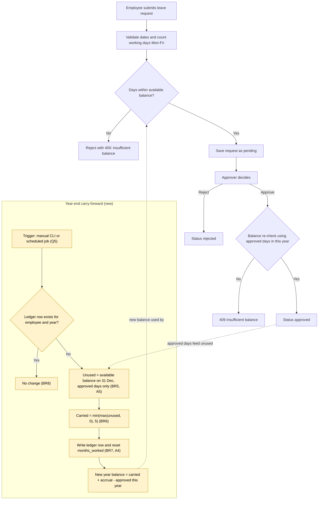

# Leave carry-forward: impact on current code

Sources: `docs/requirements/leave-carry-forward-brd.md` (BRD), `docs/requirements/leave-carry-forward.feature` (feature), and the code as of the current working tree (`app.py`, `src/leave/rules.py`, `src/leave/db.py`, `seed.py`, `index.html`, `test_leave.py`).

## Summary

Carry-forward is not built. Nothing in the code has a year, a carry record or a scheduled run, so most of the work is in the database and the balance calculation, not in the cap rule.

Three findings need a decision before build:

1. **Approved days are not year-scoped.** `approved_days()` in `app.py` sums every approved request ever. After rollover, last year's leave would be deducted again from the new year balance. This is the highest-risk defect in the change.
2. **Assumption A2 conflicts with Story 4.** A2 stores carried days in `opening_balance`, which makes them indistinguishable from other opening days. Story 4 needs them shown separately, so a separate carry record is needed.
3. **No trigger exists.** Nothing runs on a schedule (BRD open question 5), and the app never creates or migrates the schema.

## Impact by area

| Area | What exists today | What must change | Risk |
|---|---|---|---|
| **API** | Six routes in `app.py`. `GET /api/employees/<id>/balance` and `GET /api/employees` return only `available_days`. `approved_days()` (line 22) has no date filter. Approve and reject re-check the balance in `change_status()`. | Balance response adds `earned_days` and `carried_days` (Story 4). `approved_days()` counts only requests in the current year (DR-01). A carry-forward entry point is needed if the run is manual (Q5). If it is an HTTP route, it must be admin-only (DR-02). | **High.** No authentication (FIXME at `app.py:111`), so an unprotected carry route could change every balance. Missing year scope double-deducts leave. |
| **UI** | `index.html:65` shows one column, `available_days`. No year-end control. | Add earned and carried columns for the approver view (Story 4). Show carried days in the employee's request form, if they are shown there. | **Low.** Display only. Depends on the API decision above. |
| **Database** | Two tables, `employees` and `leave_requests`. `employees` has `months_worked` and `opening_balance` and no year column. `leave_requests` has no year-scoped index. No migrations (`db.py` says so). `seed.py` deletes and recreates `leave.db`. | (a) Add a carry ledger table, `carry_forward(employee_id, year, carried_days, run_at)` with primary key `(employee_id, year)`. This gives idempotency (BR8) and keeps carried days separate (Story 4). If A2 is kept instead, Story 4 cannot be met. (b) Reset `months_worked` each year (A4). (c) Migration for existing `leave.db`, since `init_db` is not called by `app.py`. | **High.** Idempotency and migration are both easy to get wrong. Changing `opening_balance` semantics would silently alter every existing balance. |
| **Business rules** (`src/leave/rules.py`) | `balance()` = opening + accrued − approved (line 19). `accrued_days()` caps at 24. The carry TODO is at line 13. | Add a pure function such as `carry_amount(unused) = min(max(unused, 0), 5)`. Extend `balance()` to take `carried_days`, or add it to opening, depending on the ledger decision. | **Low.** Pure function, easy to test. |
| **Tests** (`test_leave.py`) | Four tests, all on `rules.py`, all passing. No tests for `app.py` or `db.py`. The `.feature` file has no step definitions and no runner is installed, so the scenarios are not executed. | Unit tests for `carry_amount` and the new balance. API tests with Flask's test client for create request and approve, and for year scoping. Either add a BDD runner (for example `pytest-bdd`) or map each scenario to a pytest test by hand. | **Medium-High.** Scenarios are currently documentation only, and the API has no coverage. |
| **Scheduled jobs** | None. No cron, Task Scheduler entry, script or CLI command. | Decide the trigger (Q5). Options: a CLI command run once per year (`python carry_forward.py --year 2027`), or an OS scheduler that calls it. Either way the run must be idempotent through the ledger. Needs a log and a way to see it failed. | **High.** A missed run loses carried days with no alert. A repeated run is blocked only if the ledger is enforced. |
| **Docs** | README says accrual is 1.5 days per month (`README.md`). Code and feature use 2.0. | Correct README to 2.0 (BR1, Q1). Document the carry rule once decided. | **Low.** Misleading for demo users. |

## Leave approval process with carry-forward

Yellow nodes are new. The year-end branch runs once per employee per year, before the new year's first request.

Open for this flow: a request that spans 31 December (Q6), and whether carried days expire or are used first (Q3).

## Requirements traceability matrix

Test case IDs are proposed. Entries marked `(existing)` already pass. Entries marked `(blocked: Qn)` cannot be finalised until that open question is answered.

| Requirement ID | User story | Impacted component | Test case ID |
|---|---|---|---|
| BR6 | As an employee, I want up to 5 unused days carried into next year, so I don't lose all my leave. | `rules.py` (`carry_amount`) | TC-CF-01a (0 → 0), TC-CF-01b (3 → 3), TC-CF-01c (5 → 5), TC-CF-01d (8 → 5) |
| BR5 | As an employee, I want my unused days at year end measured from my available balance. | `rules.py` (`balance`), `app.py` (`approved_days`), carry job | TC-CF-02 |
| BR7, A2 | As an employee, I want carried days added to my new year opening balance. | `db.py` (ledger), `app.py` (`employee_balance`) | TC-CF-03 |
| Story 2, scenario 1 | As an employee, I want carried days included in my available leave, so I can book them. | `rules.py` (`balance`), `app.py` (`employee_balance`) | TC-CF-04 (5 carried, 2 months → 9 days) |
| Story 2, scenario 2 | As an employee, I want to request carried days when I have no earned days. | `app.py` (`create_request`) | TC-CF-05 |
| BR8 | As an administrator, I want the run to be safe to repeat, so balances are never double-counted. | `db.py` (ledger primary key), carry job | TC-CF-06 |
| A5, Story 3, scenario 2 | As an administrator, I want pending requests ignored in the carry calculation. | Carry job (approved days only) | TC-CF-07 |
| Story 4 | As an approver, I want to see carried days separately, so I understand an employee's balance. | `app.py` (`employee_balance`), `index.html` | TC-CF-08 (blocked: A2 / Q4) |
| A4 | As an administrator, I want earned days to restart each year, so the cap applies per year. | `db.py` / carry job (`months_worked` reset) | TC-CF-09 |
| DR-01 (derived from BR2) | As an employee, I want only this year's approved leave to reduce my balance, so last year's leave is not counted twice. | `app.py` (`approved_days`) | TC-CF-10 |
| Q5 (derived) | As an administrator, I want the run to happen once a year without manual steps. | Trigger (CLI or scheduler), deployment | TC-CF-11 (blocked: Q5) |
| DR-02 (derived from FIXME at `app.py:111`) | As an administrator, I want only authorised users to run carry-forward. | `app.py` route or CLI, authentication | TC-CF-12 (blocked: auth decision) |
| DR-03 (derived) | As a maintainer, I want existing `leave.db` files upgraded without losing data. | `db.py` (migration), `seed.py` | TC-CF-13 |
| BR1 | As an employee, I want leave to accrue at 2.0 days per month, capped at 24. | `rules.py` (`accrued_days`) | TC-EX-01, TC-EX-02 (existing) |
| BR2 | As an employee, I want available days = opening + accrued − approved. | `rules.py` (`balance`) | TC-EX-04 (existing) |
| BR3 | As an employee, I want weekends excluded from my requested days. | `rules.py` (`working_days`) | TC-EX-03 (existing) |
| BR4 | As an approver, I want approval to re-check the balance. | `app.py` (`change_status`) | None (gap). Add TC-CF-14. |

## Decisions needed before build

| Question | Recommendation |
|---|---|
| Carry storage: `opening_balance` (A2) or a ledger table? | Ledger table. It gives idempotency and meets Story 4. Requires a migration. |
| Accrual rate: 2.0 (code) or 1.5 (README)? (Q1) | 2.0. The code and feature both assume it. Fix the README. |
| Cap per calendar year or total service? (Q2) | Calendar year. This matches A1 and the approved-days scoping. |
| Expiry and use order of carried days? (Q3) | Not in scope for v1. Record as a follow-up. |
| Does the 5-day cap include carried-in days? (Q4) | Yes, the cap applies to total unused, so the stock never exceeds 5 carried. Confirm with the business. |
| Trigger: scheduled job or manual run? (Q5) | Manual CLI command run once per year, with the ledger guarding repeats. Add a scheduler later if needed. |
| Pending and cross-year requests at 31 Dec? (Q6) | Pending is not used (A5). A request spanning 31 Dec is split by year. Needs business confirmation. |
| Fractional unused days? (Q7) | Carry as-is up to 5, so 4.5 carries 4.5. Confirm. |
